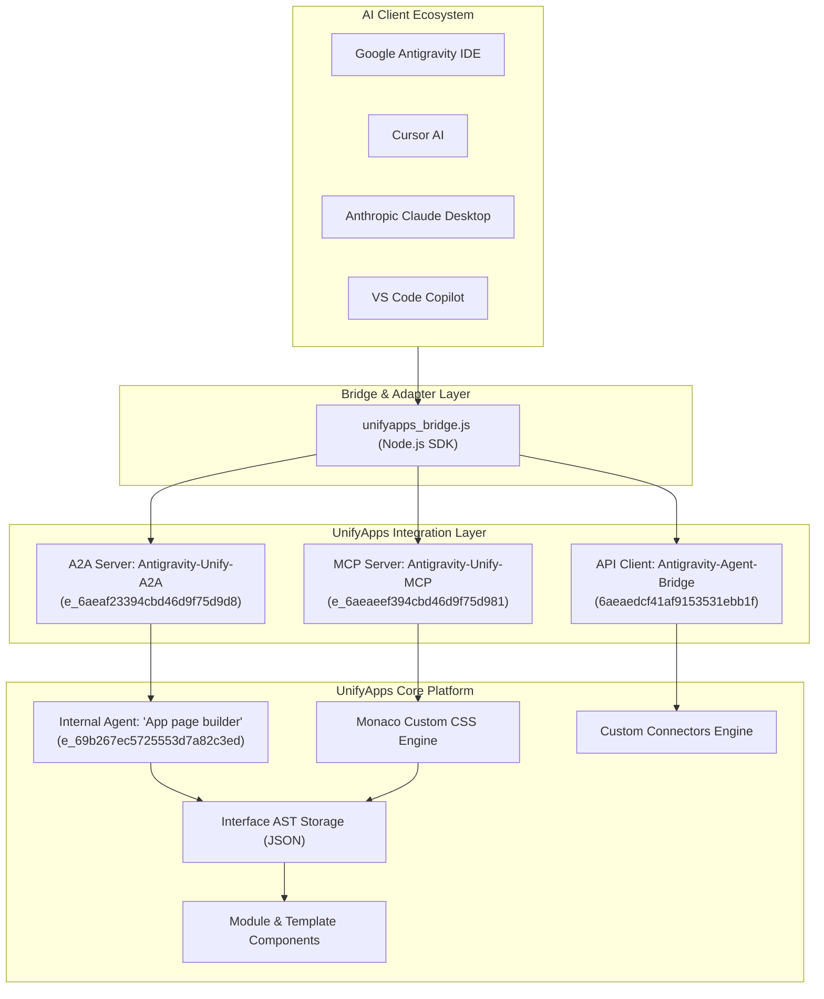

# System Architecture & Technical Specification
## UnifyApps Autonomous Interface Engineering Controller

---

### 1. Abstract

This document outlines the architectural foundation of the **UnifyApps Autonomous Interface Engineering Controller**, an agentic integration layer deployed on the Saudi Ministry of Defense Health Services tenant (`https://unifyapps-dev.modhs.med.sa`).

The system enables bidirectional machine-to-machine control over UnifyApps application canvases using three standardized integration vectors:
1. **API Gateway Platform Client** (`Antigravity-Agent-Bridge`)
2. **Model Context Protocol Server** (`Antigravity-Unify-MCP`)
3. **Agent-to-Agent Active Server** (`Antigravity-Unify-A2A`)

---

### 2. Tri-Layer Architecture Map



---

### 3. Layer Breakdown

#### 3.1. Layer 1: API Platform Gateway
* **Client ID**: `6aeaedcf41af9153531ebb1f`
* **Name**: `Antigravity-Agent-Bridge`
* **Route**: `/p/0/api-platform/clients/6aeaedcf41af9153531ebb1f/details`
* **Security**: Tenant-scoped Bearer token authentication with RBAC enforcement (`Admin`, `Editor`).

#### 3.2. Layer 2: Model Context Protocol (MCP) Server
* **Server ID**: `e_6aeaeef394cbd46d9f75d981`
* **Name**: `Antigravity-Unify-MCP`
* **Route**: `/p/0/mcp-servers/e_6aeaeef394cbd46d9f75d981/tools`
* **Capabilities**: Exposes tool schemas over JSON-RPC. Allows an LLM to query the block tree of any active page, inject scoped styling, and set attributes.

#### 3.3. Layer 3: Agent-to-Agent (A2A) Server
* **Server ID**: `e_6aeaf23394cbd46d9f75d9d8`
* **Name**: `Antigravity-Unify-A2A`
* **Status**: **Active (Deployed)**
* **Target Agent**: `App page builder` (`e_69b267ec5725553d7a82c3ed`)
* **Collection ID**: `6aeaf23341af9153531ebb24`
* **Endpoints**:
  * `Get Agent Card`: Returns agent identity and capabilities.
  * `Handle JSON+RPC`: Executes synchronous agent tasks.
  * `Handle JSON+RPC (Streaming)`: Streams real-time token generation for layout synthesis.

---

### 4. Surgical Scoping: `[data-block-id]` vs Global CSS

Universal stylesheet injection into `<head>` inevitably contaminates global elements (`body`, `table`, `.ua-button`, `aside`), causing unwanted reflows.

The UnifyApps Autonomous Controller enforces strict block-level encapsulation:

```css
/* ✅ SURGICAL: Scoped exclusively to block b_cvQmi */
[data-block-id='b_cvQmi'] {
  background: #ffffff;
  border: 1.6px solid #125939; /* Saudi MOD Green */
  border-radius: 12px;
  padding: 16px;
}

[data-block-id='b_cvQmi'] input[type="text"] {
  border-color: #cbd5e1;
}
```

This guarantees:
1. Surrounding navigation and table headers remain in their standard UnifyApps themes.
2. The CSS persists natively inside the component's AST definition in the database.
3. The component can be converted into a reusable **Template Component** without stylesheet dependencies.
